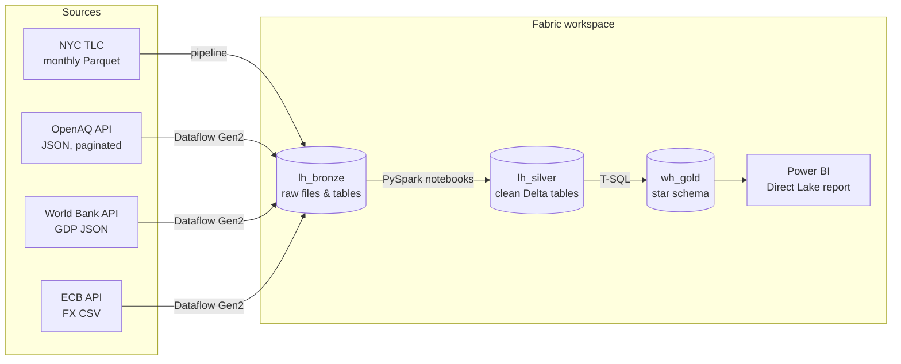

# NYC Urban Analytics on Microsoft Fabric

Course project (Itransition, Data Engineering group): a unified analytics platform on
Microsoft Fabric that combines urban mobility (NYC taxi trips), air quality (OpenAQ) and
macro-economic data (World Bank GDP, ECB USD/EUR rates) in a medallion lakehouse and a
star-schema warehouse, with Power BI dashboards.

## Architecture

## Repository layout

| Path | Content |
|---|---|
| `config/sources.json` | every data source in one place (months, countries, pollutants, URLs) |
| `config/fabric.json` | target Fabric workspace |
| `fabric/` | workspace items (pipelines, dataflows, notebooks) and connections, see [fabric/README.md](fabric/README.md) |
| `tools/fabric_sync.py` | deploys `fabric/` to the workspace and exports it back through the Fabric REST API |
| `sql/` | warehouse DDL, load scripts and analytical queries |
| `docs/PLAN.md` | project plan split into segments, with progress |
| `docs/DATA_DICTIONARY.md` | every Bronze and Silver table and column |
| `docs/` | lineage, governance |

## Status

See [docs/PLAN.md](docs/PLAN.md).
